# Dossier de Cadrage & Matrice de Traçabilité — Module Commercial « Lead → C.Fitness OS » (Lot 2)

> [!IMPORTANT]
> **Document de cadrage AVANT DÉVELOPPEMENT** établi à partir de l’archive `CFITNESS_OS_LEAD_Audit_en_cours_2026-11-17.zip` (**version `0.4` du 17/11/2026**, **84 fichiers**, **`1 682` entrées** `LEAD-0001` à `LEAD-1682`).  
> Conformément à `LIRE_EN_PREMIER_DEV_IA.txt`, `PROMPT_DEMARRAGE_IA.txt` et `07_CAHIER_DES_CHARGES_CFITNESS_OS.txt`, **aucune ligne de code métier (`src/`, `src-rust/`) n’est modifiée tant que ce cadrage et ses décisions ouvertes n’ont pas été validés.**

---

## 1. Synthèse de l’audit Lead v0.4 & Règles de gouvernance

### 1.1 Périmètre audité et statut des preuves
- **Source auditée** : logiciel CRM/Commercial **Lead / Ma Salle de Sport**, observé en session navigateur sur **C.Fitness Beynost** (`ADMIN`, `MANAGER`, `COMMERCIAL`) et **C.Fitness Lyon Carré de Soie** (`ADMIN`).
- **Volume inventorié (`INVENTAIRE_LEAD.json`)** : **`1 682` entrées** (`LEAD-0001` à `LEAD-1682` dont dernier ID chronologique `LEAD-1682`, réparties sur `63` rubriques racines) :
  - **`1 410` entrées `observe`** : vérifiées visuellement en session navigateur (navigation, formulaires, filtres, colonnes, éditeurs, mesures responsive `390×844` et `820×1180`, 24 captures probantes sur 26).
  - **`157` entrées `documente`** : issues de `33` pages d’aide officielle (`DOCUMENTATION_OFFICIELLE.json`) et des transcriptions automatiques des `13` vidéos de formation identifiées (`FORMATIONS_ANALYSEES.json`).
  - **`115` entrées `a_verifier`** : points conditionnels, étapes d’assistants nécessitant écriture, calculs serveur et exemples absents dans les deux clubs (`ECARTS_ET_QUESTIONS.json`, `B01`–`B11`, `EX01`–`EX16`).

> [!WARNING]
> **Règle de véracité (non-parité 100 %)** : les compteurs d’entrées (`1 682`) mesurent la traçabilité de l’audit et **non** un pourcentage d’exhaustivité certifiée du logiciel Lead. Aucune capture réseau HTTP/HAR, aucun code source privé, aucun secret API et aucune action d’écriture réelle (envoi, paiement Stripe, publication, suppression, import) n’ont été exécutés pendant l’audit.

### 1.2 Séparation stricte avec la brique RH « Mon compte » (V1.16)
| Domaine C.Fitness OS | Emplacement validé | Périmètre fonctionnel | État actuel dans le dépôt |
| :--- | :--- | :--- | :--- |
| **RH « Mon compte »** | `MonCompteRhHubView.tsx` + `PlanningHrView.tsx` | Socle RH Skello V1.16 (`MC01`–`MC13`, RBAC `6×44`, traçabilité `91/1605`, badgeuse, paie Silae) | Déjà implémenté et vérifié |
| **Module Commercial / CRM (Lead)** | `CrmView.tsx` + **nouveaux sous-écrans dédiés** (dans `AdminShell.tsx`) | Acquisition, Prospects (`10` statuts), Clients (`2` statuts), Activités (`9` filtres), Planning RDV, Messagerie WhatsApp, Communication (`6` écrans), Paramètres CRM (`14` rubriques), Statistiques (`8` vues), Ventes, Formulaires, Traceur `1 682` | Partiel aujourd’hui (Kanban, HubSpot 360, Table, conversion Heitz, téléphonie 04/07 dans `TelephonyView.tsx`) → **à compléter après validation** |
| **Planning transversal OS** | Agrégation visuelle dans le Planning global | Vue unifiée RDV commerciaux (Lead) + Planning sportif (Mywellness) + Créneaux RH, **avec badge d’origine et contrôle de droits distincts** | Consolidation multi-sources déjà amorcée |

---

## 2. Proposition de Navigation & Architecture d’écrans dans C.Fitness OS

### 2.1 Carte d’architecture proposée

```mermaid
flowchart TD
    NAV["Barre latérale CRM & Commercial (AdminShell.tsx)"] --> CORE["9 Modules Métier CRM"]
    NAV --> COMM["Sous-menu Communication (ADMIN / MANAGER)"]
    NAV --> CFG["Paramètres Commercial / Lead — 14 rubriques (ADMIN / MANAGER)"]
    NAV --> TRACE["Traçabilité Audit Lead (1 682 entrées + 26 captures + 23 écarts)"]

    CORE --> M1["Rechercher (/search)"]
    CORE --> M2["Prospects (/lead & /lead/:id) — 10 statuts, import Excel 11 col., segments"]
    CORE --> M3["Clients (/client) — 2 statuts, Vacances, Décrochage Heitz"]
    CORE --> M4["Messagerie (/messaging) — WhatsApp fenêtre 24h & modèles"]
    CORE --> M5["Activités (/todos) — 9 types, 6 vues temporelles, purge retards"]
    CORE --> M6["Planning RDV (/planning) — Types réservables, lien isolé, collisions RDV-01"]
    CORE --> M7["Statistiques (/statistics) — 8 tableaux Tunnel & Activité, N-1, multi-club"]
    CORE --> M8["Ventes (/sales) — Filtre fin d'abonnement, mix ventes"]
    CORE --> M9["Formulaires (/forms) — Éditeur 9 types champs, UI-01 corrigé"]

    COMM --> C1["Modèles (/template) — Email 12 blocs, SMS, WhatsApp Marketing/Utility"]
    COMM --> C2["Campagnes (/campaign) — Email 4 étapes, SMS segments/oppositions"]
    COMM --> C3["Campagnes UTM (/utm_campaign) — Prospects, Abonnés, Conversion"]
    COMM --> C4["Scénarios (/scenario) — Auto/Manuel, 6 étapes, Actif/Verrouillé, replis WA-01"]
    COMM --> C5["SMS envoyés (/sms) — 5 filtres statuts + export"]
    COMM --> C6["Emails échangés (/email) — 6 filtres statuts + export"]
```

### 2.2 Correspondance complète des routes Lead → C.Fitness OS
| Patron d’URL Lead | Rubrique Lead | Cible C.Fitness OS proposée | Profondeur auditée dans Lead |
| :--- | :--- | :--- | :--- |
| `/club/{club}/search` | Rechercher un contact | Barre recherche globale CRM (haut `CrmView`) | Observé (`LEAD-0001`), recherche détaillée non testée |
| `/club/{club}/lead` | Prospects | Onglet **Prospects** (Kanban + Tableau + Import Excel + Sélection multiple) | Observé (`10` statuts, filtres, dialogue ajout, sélection multiple segments) |
| `/club/{club}/lead/{contact}` | Fiche prospect | Vue **Fiche 360°** (responsive *Sommaire / Détails*) | Observé (`83` entrées : édition, activité, interaction, SMS, email, RDV) |
| `/club/{club}/client` | Clients | Onglet **Clients** (`Client` / `Client enseigne` + Vacances + Décrochage) | Observé (`23` entrées + `12` Fiche client ; calendrier vacances lu) |
| `/club/{club}/messaging/{id}` | Messagerie WhatsApp | Onglet **Messagerie** (fil + sélecteur modèles + compteur 24h) | Observé sans envoi (`19` entrées + `93` WhatsApp ; mobile `015`) |
| `/club/{club}/todos` | Activités | Onglet **Activités** (`9` filtres `*..SMS`, `6` échéances, `12` statuts) | Observé (`54` entrées ; appels, demandes contact/email, tâche SMS) |
| `/club/{club}/planning` | Planning RDV | Onglet **Planning Commercial** + liaison Planning global OS | Observé (calendrier, RDV neuf + gestion types réservables + Stripe) |
| `/club/{club}/statistics` | Statistiques | Onglet **Statistiques** (`8` tableaux : Tunnel `4` + Activité `4`) | Observé (`38` entrées ; `5` raccourcis, `compareToPreviousYear`, multi-club) |
| `/club/{club}/sales` | Ventes | Onglet **Ventes** (filtre fin d’abonnement *Se termine après/avant*) | Observé (`18` entrées ; détail transaction distinct non démontré) |
| `/club/{club}/forms` | Formulaires | Onglet **Formulaires** (constructeur par sections, réponses, export) | Observé (`25` entrées ; éditeurs/réponses vides, `UI-01` & `RSP-01` à corriger) |
| `/club/{club}/template` | Modèles | Sous-vue **Communication > Modèles** (Email/SMS/WhatsApp) | Observé (`24` Modèles + `64` Email + `65` Composeur + `93` WhatsApp) |
| `/club/{club}/campaign` | Campagnes | Sous-vue **Communication > Campagnes** (Email 4 étapes + SMS) | Observé partiellement (`13` Campagnes, `14` SMS, `9` Email ; `RSP-02/03`) |
| `/club/{club}/utm_campaign` | Campagnes UTM | Sous-vue **Communication > Campagnes UTM** | Observé (`9` entrées ; Beynost consulté) |
| `/club/{club}/scenario/{id}` | Scénarios | Sous-vue **Communication > Scénarios** (Auto/Manuel, états, replis) | Observé (`47` entrées ; édition mail `SC-01`, `SC-02`, `WA-01`) |
| `/club/{club}/sms` & `/email` | Journaux SMS / Emails | Sous-vue **Communication > Logs SMS & Emails** (+ exports) | Observé (`14` SMS envoyés + `13` Emails échangés) |
| `/club/{club}/settings/*` (`14` pages) | Paramètres CRM | Sous-vue **Paramètres Commercial / Lead** (`14` onglets dédiés) | Observé sur Desktop, Mobile `390px` et Tablette `820px` |

---

## 3. Matrice de Traçabilité détaillée (`INVENTAIRE_LEAD.json` — `1 682` entrées)

Le tableau ci-dessous partitionne sans chevauchement ni omission les **63 rubriques** de `INVENTAIRE_LEAD.json` pour un total vérifié de **`1 682` entrées** (`1 410` `observe`, `157` `documente`, `115` `a_verifier`). Aucune entrée n’est supprimée ou ignorée.

| # | Famille (`INVENTAIRE_LEAD.json`) | Nb d’entrées | Écran C.Fitness OS cible | Rôles serveur cibles | Actions, Règles & Contraintes clés | Preuve source / Critère de recette fictive | Réserves / Écarts liés |
| :-: | :--- | :-: | :--- | :--- | :--- | :--- | :--- |
| 1 | **Navigation principale** (`Navigation principale`) | **15** | Barre latérale Commercial | `ADMIN`, `MANAGER`, `COMMERCIAL` | Recherche globale, sélecteur multi-clubs, 9 entrées cœur + Communication + Paramètres | Audit UI ; recette navigation desktop/mobile & multi-club | `ST-03` (accès direct URL) |
| 2 | **Communication (menu)** (`Communication`) | **6** | Sous-menu Communication | `ADMIN`, `MANAGER` | Masqué & bloqué au serveur pour `COMMERCIAL` | Audit UI ; recette HTTP `403` si accès direct en `COMMERCIAL` | — |
| 3 | **App (liens externes)** (`App`) | **2** | Liens passerelles OS | `ADMIN`, `MANAGER`, `COMMERCIAL` | MaSalleDeSport & ClubConnect (`club/null` constaté) | Non copié tel quel ; lien interne CFitness | — |
| 4 | **Paramètres — navigation, Sources & général** (`Paramètres`) | **74** | Paramètres Commercial (`14` rubriques + `58` Sources) | `ADMIN`, `MANAGER` | `app-settings`, `sms`, `marketing`, `users`, `meetings`, `automation`, `prospects`, `segments`, `script`, `49` sources (`9` catégories), `exclusions`, `notifications`, `whatsapp`, `partners` | `PARAMETRES_RESPONSIVE_2026-11-17.json` (28 entrées à 390/820 px) | Open menu `820px` hors cadre |
| 5 | **Prospects (liste & sources proposées)** (`Prospects`) | **58** | Prospects (`/lead`) | `ADMIN`, `MANAGER`, `COMMERCIAL` | 10 statuts, recherche nom/mail/tél, filtres Source/Assigné/Segment/Jamais consulté, pagination | Recette sur jeu fictif combinant filtres + zéro fuite entre clubs | `PR-01`, `ST-03` |
| 6 | **Ajouter un prospect** (`Ajouter un prospect`) | **21** | Modale / Volet Ajout Prospect | `ADMIN`, `MANAGER`, `COMMERCIAL` | Identité, mobile, email, date naissance, origine, commercial, RGPD (**ne pas précocher par défaut sans décision**) | `captures/021`, `022` ; recette validation doublon email/tél | Consentement précoché source |
| 7 | **Import prospects (Excel)** (`Import prospects`) | **11** | Modale Import Excel (`/lead`) | `ADMIN`, `MANAGER` | 11 colonnes strictes (`template_import_prospects_officiel.xlsx`), 1re ligne ignorée, email requis | `sources/*.xlsx` (SHA-256 `9c1557ae...`) ; recette import/rejets fictifs | `EX16` (règles doublons/rejet) |
| 8 | **Fiche prospect** (`Fiche prospect`) | **83** | Fiche 360° (`/lead/:id`) | `ADMIN`, `MANAGER`, `COMMERCIAL` | Onglets *Sommaire/Détails* mobile, modif contact, activité future, interaction passée, SMS, email, RDV | Recette workflow complet sans perte de contexte | `DOC-02` (*Histoire sportive*) |
| 9 | **Clients & Fiche client** (`Clients`, `Fiche client`) | **35** | Clients (`/client`) | `ADMIN`, `MANAGER`, `COMMERCIAL` | 2 statuts (*Client*, *Client enseigne*), calendrier **Vacances** (suspend relances sans toucher au contrat), **Décrochage** | Recette vacances fictives + simulation décrochage Heitz | `EX13` (états abo), `B09` |
| 10 | **Contacts (global)** (`Contacts`) | **1** | Recherche / Fiche contact | `ADMIN`, `MANAGER`, `COMMERCIAL` | Index unifié contact + distinction prospect/client | Recette déduplication inter-statuts | — |
| 11 | **Activités** (`Activités`) | **54** | Activités (`/todos`) | `ADMIN`, `MANAGER`, `COMMERCIAL` | 9 types (`*`, `APPOINTMENT`, `CONTACT`, `REVIEW`, `SCHEDULED_CALL/EMAIL/SMS`, `MAIL`, `SMS`), 6 échéances, 12 statuts, purge retards | `FILTRES_ACTIVITES_2026-11-17.json` ; recette purge journalisée | `EX07`, `EX08`, `EX09` |
| 12 | **Planning & Rendez-vous** (`Planning`, `Rendez-vous`, `Gestion rendez-vous`, `Type de rendez-vous`, `Indisponibilité`) | **49** | Planning RDV & Paramètres RDV | `ADMIN`, `MANAGER`, (`COMMERCIAL` lecture/résa) | Durée, fréquence, délai min, capacité (`0` = illimité), notif prospect/commercial/club, lien isolé, horaires/jour, indisponibilités, `%club%` | `captures/008`, `009` ; recette réservation concurrente & collision | `RDV-01`, `EX11` |
| 13 | **Statistiques** (`Statistiques`) | **38** | Statistiques (`/statistics`) | `ADMIN`, `MANAGER`, (`COMMERCIAL` si autorisé) | 8 tableaux (`4` Tunnel + `4` Activité), 5 raccourcis période + manuel, *Ignorer archivés*, `compareToPreviousYear`, multi-club | `STATISTIQUES_ANGLES_2026-11-17.json`, `captures/023` ; recette calcul à la main | `ST-01`, `ST-02`, `ST-03` |
| 14 | **Ventes** (`Ventes`) | **18** | Ventes (`/sales`) | `ADMIN`, `MANAGER`, `COMMERCIAL` | Recherche, filtre Commercial/Ticket/Abonnement, filtre date **Se termine après / avant** (fin d’abonnement) | Recette rapprochement fictif Vente vs Abonnement Heitz | Rapprochement ERP réel |
| 15 | **Formulaires** (`Formulaires`) | **25** | Formulaires (`/forms`) | `ADMIN`, `MANAGER` (`COMMERCIAL` lecture) | Éditeur par sections, publication exigeant Nom/Prénom/Email, réponses, copier vers club, **titre colonne `Nom du formulaire`** | `captures/011`, `024` ; recette mobile `RSP-01` & blocage `ACL-01` | `UI-01`, `ACL-01`, `EX01`, `EX02`, `RSP-01` |
| 16 | **Modèles (liste & génériques)** (`Modèles`) | **24** | Communication > Modèles | `ADMIN`, `MANAGER` | Filtres SMS / Email / WhatsApp, recherche, statuts validation, envoyés/ouverts, actions | Recette CRUD modèles fictifs + masquage `COMMERCIAL` | — |
| 17 | **Email, Composeur & Modèles Email** (`Email`, `Composeur email`, `Modèle email`, `Modèles email`) | **140** | Éditeur & Modèles Email | `ADMIN`, `MANAGER` | 27 modèles comparés, 12 blocs (6 détaillés + 6 à préciser `EX03`), 18 polices, en-tête (logo 2 Mo, marges, arrondi), iframe HTML | `captures/017`, `018` ; recette responsive mobile `RSP-04` | `EX03`, `RSP-04`, `B04` |
| 18 | **Campagnes, Email, SMS & UTM** (`Campagnes`, `Campagne email`, `Campagne SMS`, `Campagnes UTM`) | **45** | Campagnes & Campagnes UTM | `ADMIN`, `MANAGER` | Email 4 étapes (*Cibler, Composer, Objet, Vérifier* + code validation), bilan 4 compteurs ; SMS (segments, 12 statuts, `Du/Au`, oppositions, 159/160 car., différé) ; UTM (Prospects, Abonnés, Conversion) | `captures/020`, `025`, `026` ; recette sans double envoi, `STOP`, mobile `RSP-02/03` | `CM-01`, `CM-02`, `SMS-01`, `RSP-02`, `RSP-03`, `EX04`, `EX10` |
| 19 | **SMS envoyés & Emails échangés** (`SMS envoyés`, `Emails échangés`) | **27** | Journaux Communication | `ADMIN`, `MANAGER` | Statuts SMS (*Tous, À envoyer, Envoyé, Pas assez de crédit, Erreur*) & Email (+ *Reçu, En cours d’envoi*) + exports Excel | Recette traçabilité erreur + reprise contrôlée | `EX15` |
| 20 | **Modèles SMS** (`Modèle SMS`) | **8** | Éditeur de modèles SMS | `ADMIN`, `MANAGER` | Variables dynamiques, comptage caractères GSM/Unicode, prévisualisation | Recette encodage avec variables substituées | `SMS-01` |
| 21 | **WhatsApp & Messagerie WhatsApp** (`WhatsApp`, `Messagerie WhatsApp`, `Modèles WhatsApp existants`, `Formation WhatsApp`) | **116** | Modèles & Messagerie WhatsApp | `ADMIN`, `MANAGER` (`COMMERCIAL` messagerie) | Fenêtre 24h Meta, galerie médias (JPG/PNG 5 Mo), limites (`100/1024/60/25` car., `10` boutons Appeler/URL statique-dynamique/Réponse rapide), séparation statut Meta vs complétude, zéro brouillon auto | `captures/010`, `015`, `016` ; recette fenêtre ouverte/fermée & `INC-001` | `WA-01`, `WA-02`, `INC-001`, `B05`, `EX05`, `EX06` |
| 22 | **Scénarios** (`Scénarios`) | **47** | Communication > Scénarios | `ADMIN`, `MANAGER` | Auto/Manuel, conditions source/assignation, 6 étapes (`Minutes/Heures/Jours`), étape existante grisée sauf contenu mail, états *Inactif / Actif / Verrouillé*, 3 replis WhatsApp | `captures/005` ; recette verrouillage, concurrence, vacances | `SC-01`, `SC-02`, `WA-01`, `EX14` |
| 23 | **Segments** (`Segments`) | **126** | Paramètres > Segments (`95` icônes + `15` couleurs) | `ADMIN`, `MANAGER` (`COMMERCIAL` assignation selon réglage) | Palette 15 couleurs, bibliothèque 95 icônes, code, ajout groupé par sélection multiple | `captures/007`, `013`, `014` ; recette multi-segments | `EX12` |
| 24 | **Paramètres spécifiques** (`Gestion prospects`, `Notifications`, `Passage statut client`, `Email & SMS de service`, `Communications de service`, `Crédits SMS`, `Profil du club`, `Utilisateurs`, `Script de vente`, `Préférences`, `Préférences de l’app`) | **74** | Onglets Paramètres Commercial | `ADMIN`, `MANAGER` | Règle archivage sur réponse entrante, 6 messages service (`rdv-date`, `rdv-heure`), script de vente riche, 4 familles notifications, solde crédits SMS, 194 pays | `captures/006`, `012`, `016` ; recette archivage fictif | `PR-01` |
| 25 | **Intégrations & API partenaires** (`Intégrations`, `API partenaires`) | **50** | Paramètres > Connecteurs & API | `ADMIN` (`MANAGER` lecture selon réglage) | 9 partenaires (*Stripe, Facebook, Google, WhatsApp, Heitz, Résamania V2, Deciplus, ClickFunnels, Funnelo*), webhook `clubEntry` & Stripe | `captures/003`, `004`, `04_RELEVE_API.json` ; recette webhook idempotent test | `API-01`, `IN-01`, `IN-02`, `B06` |
| 26 | **Comparaisons Rôles** (`Manager`, `Commercial`, `Gestion externe`, `Gestion externe des utilisateurs`) | **239** | Matrice RBAC Serveur CRM | `ADMIN` (gouvernance) | Comparatif UI `ADMIN`/`MANAGER`/`COMMERCIAL`, `COACH`/`BASIC` obsolètes, non-assimilation de ClubConnect aux droits Lead | `MODULES_MANAGER_2026-11-17.json`, `MODULES_COMMERCIAL_2026-11-17.json` | `ACL-01`, `B08` |
| 27 | **Documentation, Formation & Aide** (`Documentation`, `Formation`, `Aide`) | **162** | Traçabilité & Aide contextuelle | Tous | 33 pages officielles + 13 vidéos transcrites ; aide non bloquante (ne pas reproduire bannières bloquantes `001`/`002`) | `DOCUMENTATION_OFFICIELLE.json`, `FORMATIONS_ANALYSEES.json` | `DOC-02` |
| 28 | **À contrôler & Synthèses transverses** (`À contrôler`, `Mobile`, `Responsive`, `Frontend`, `Autres clubs`) | **134** | Registre Qualité & Recette Lot 2 | QA / `ADMIN` | Points à clarifier + 4 écarts responsive mobiles + vérif multi-club Beynost & Carré de Soie | `ECARTS_ET_QUESTIONS.json`, `12_FILTRES_ET_RESPONSIVE_2026-11-17.txt` | `RSP-01..04`, `B01..B11` |

> **Total vérifié : `1 682` entrées (`1 410 observe` + `157 documente` + `115 a_verifier`) sur les `63` rubriques sources.**

---

## 4. Matrice des Rôles & Permissions Serveur (`ADMIN`, `MANAGER`, `COMMERCIAL`)

> [!CAUTION]
> **Règle d’isolation stricte** : l’absence d’un lien dans l’interface Lead (ex. menu mobile à 8 liens) ou la présence visuelle d’une icône (ex. corbeille de formulaire `ACL-01`) **ne prouvent pas la règle serveur**. Dans C.Fitness OS, chaque endpoint API (`/api/lead/*`) vérifiera obligatoirement **Rôle × Action × Périmètre de club** côté backend Rust/Axum et TypeScript.

| Module / Action | `ADMIN` (Multi-clubs) | `MANAGER` (Club(s) assignés) | `COMMERCIAL` (Périmètre commercial) | `COACH` / `BASIC` |
| :--- | :--- | :--- | :--- | :--- |
| **Prospects (`/lead`)** | Lire, créer, modifier, importer Excel, sélection multiple, archiver | Lire, créer, modifier, importer Excel, sélection multiple | Lire, créer, modifier, **sans sélection multiple massive par défaut (à valider)** | Obsolètes (désactivés) |
| **Clients (`/client`)** | Lire, modifier, Vacances, Décrochage, sélection multiple | Lire, modifier, Vacances, Décrochage | Lire, consulter fiche ; **sélection multiple absente** | Obsolètes |
| **Messagerie WhatsApp & Appels** | Complet par club | Complet par club | Messagerie individuelle / conversation sur fiche | Obsolètes |
| **Activités (`/todos`)** | Toutes activités + purge retards | Toutes activités club + purge retards | Ses activités / selon périmètre club | Obsolètes |
| **Planning RDV** | Voir + réserver + gérer types & indisponibilités | Voir + réserver + gérer types | Voir + poser RDV (pas de config types RDV) | Obsolètes |
| **Statistiques (`/statistics`)** | Multi-club + exports | Club(s) + exports | **Conditionnel** selon paramètre `app-settings` du club | Obsolètes |
| **Ventes (`/sales`)** | Lecture complète + réconciliation ERP | Lecture club | Lecture club | Obsolètes |
| **Formulaires (`/forms`)** | Créer, éditer, publier, supprimer, copier | Créer, éditer, publier, copier | **Lecture seule** (pas d’ajout ni édition ; **`ACL-01` : suppression bloquée `403` et icône corbeille retirée**) | Obsolètes |
| **Communication (`6` sous-modules)** | Complet (`Modèles`, `Campagnes`, `UTM`, `Scénarios`, `Logs`) | Complet sur son club | **Refus `403` + masqué du menu** | Obsolètes |
| **Paramètres CRM (`14` rubriques) & Intégrations** | Complet organisation & clubs | Paramètres métier club (hors secrets critiques org) | **Refus `403` + masqué du menu** | Obsolètes |

---

## 5. Architecture Cible, Modèle de Données & Contrats API

### 5.1 Les 29 entités candidates (issues du cahier `07`, Section 12 — à adapter au schéma C.Fitness OS)
- **Gouvernance & Identité** : `Organization`, `Club`, `User`, `Role`, `Permission`, `AuditEvent`.
- **Contacts & Segmentation** : `Contact`, `ContactClub`, `ConsentEvent` (horodaté + canal), `Source` (`49` sources / `9` catégories), `Segment`, `ContactSegment`, `VacationPeriod` (début, fin, auteur, sans impact contrat Heitz).
- **Opérations Commerciales & Ventes** : `Activity`, `AppointmentType`, `AvailabilityRule`, `Appointment` (distinction provisoire vs confirmée), `Sale`, `SubscriptionReference`.
- **Communication & Automatisation** : `Conversation`, `Message`, `TemplateVersion`, `Campaign`, `AudienceSnapshot`, `ScenarioVersion`, `Enrollment`, `ScheduledAction`.
- **Connecteurs externes** : `IntegrationConnection`, `ExternalMapping` (`Heitz`, `Mywellness`, `Stripe`, `WhatsApp Meta`, etc.).

### 5.2 Contrats API & Import identifiés dans l’audit
1. **Webhook entrant Lead compatible** (`DOC-003`, `04_RELEVE_API.json`) :
   - **Méthode & URL source** : `POST /api/lead/webhooks/clubEntry`
   - **Champs requis (contact)** : `apiKey`, `club`, `email`, `lastname`, `firstname`
   - **Champ requis supplémentaire (essai)** : `offername` *(écart `API-01` à clarifier sur l’unicité d’endpoint contact/essai)*
   - **Champs facultatifs** : `gender`, `birthdate`, `zipcode`, `city`, `street`, `country`, `message`, `source`, `utm_source`, `utm_campaign`, `utm_medium`, `isWix`, `phone`, `source_url`
   - **Exigences CFitness** : clé API par header (hors URL/frontend), idempotence, déduplication email/tél, validation stricte et journal d’erreurs.
2. **Webhook Paiement RDV Stripe** :
   - **Patron source** : `POST /api/v2/appointment/webhooks/stripe/{club}`
   - **Exigences CFitness** : signature webhook vérifiée côté Rust/Axum, création du contact tolérée en amont mais **confirmation définitive du créneau uniquement sur événement Stripe payé**, gestion expiration / échec / remboursement.
3. **Import Excel officiel** (`sources/template_import_prospects_officiel.xlsx`, SHA-256 `9c1557ae14a78dac50ee6d8b9e5e7230d3be4c6308c24690866b72378dfa4562`) :
   - **11 colonnes ordonnées** (1re ligne d’en-tête ignorée) : `Genre`, `Prénom`, `Nom`, `Email` *(requis)*, `Téléphone`, `Rue`, `Code postal`, `Ville`, `Date de naissance` (`DD/MM/YYYY`), `Accepte les communications commerciales` (`VRAI`/`FAUX`), `Commentaire`.
   - **Exigences CFitness** : prévisualisation avant import, rapport détaillé des lignes rejetées/doublons et aucune écriture silencieuse.

---

## 6. Corrections Responsive & Défauts UX/UI obligatoires

| ID Référence | Constat exact dans Lead | Preuve audit | Correction obligatoire dans C.Fitness OS |
| :--- | :--- | :--- | :--- |
| **`RSP-01`** | Éditeur de formulaire à `390 px` : bouton *Ajouter une section* (`x=352..516`) coupé par `overflow-x: hidden` | `captures/024` | Empilement vertical des panneaux sur mobile (`< 768 px`) ; tous boutons `100%` dans le viewport |
| **`RSP-02`** | Assistant campagne email à `390 px` : bouton *Suivant* (`x≈710..790`) hors écran | `captures/025` | Stepper 4 étapes compact + barre d’action collante (*sticky bottom*) dans le cadre |
| **`RSP-03`** | Nouvelle campagne SMS : crash **`DialogClose must be used within Dialog`** lors du passage tablette (`820 px`) → mobile (`390 px`) | `captures/026` | Page / modale unique stable sans démontage conditionnel de contexte Dialog au resize |
| **`RSP-04`** | Éditeur de modèle email à `390 px` : bouton *Aperçu* (`x≈583`) et en-tête hors cadre | `SOUS_ECRANS_RESPONSIVE` | Bascule par onglets **Éditer / Aperçu** sous mobile au lieu de 2 colonnes côte à côte |
| **`UI-01`** | Liste *Formulaires* : 1re colonne intitulée par erreur **`Prénom`** | `ECARTS_ET_QUESTIONS.json` | Renommer en **`Nom du formulaire`** |
| **`IN-01` / `IN-02`** | Carte Heitz affichée *Non connectée* malgré offres actives ; fiche Funnelo citant ClickFunnels | `captures/004`, `ECARTS` | État réel de synchro (horodatage + dernier flux + erreur) et libellé propre par partenaire |
| **`INC-001`** | L’assistant WhatsApp peut créer un brouillon vide sans clic *Enregistrer* | `00_ANALYSE_A_VALIDER.txt` | **Création explicite uniquement sur clic Enregistrer / Brouillon**, jamais sur simple navigation d’étape |
| **Accessibilité & Aides** | Boutons icônes sans `aria-label` (`+`, upload, corbeille) et annonces superposées bloquant l’UI (`001`, `002`) | `captures/001`, `002`, `015` | `aria-label` systématique, info-bulle sur contrôles grisés, aucune bannière modale bloquante |

---

## 7. Écarts, Blocages, Exemples & Décisions à valider avant le Code

### 7.1 Registre des 23 écarts (`ECARTS_ET_QUESTIONS.json`)
| ID | État audit | Synthèse & Impact pour C.Fitness OS |
| :--- | :--- | :--- |
| **`API-01`** | Ouvert | Clarifier les deux types d’appels *contact* et *essai* sur `/api/lead/webhooks/clubEntry` (`offername`, retours d’erreur) |
| **`WA-01`** | Clarifié UI (non testé) | Scénario *Message direct* + fenêtre 24h fermée : 3 replis (*ne pas envoyer / modèle / SMS*) à tester sur sandbox fictive |
| **`WA-02`** | Ouvert | Divergence entre statut liste (*En cours d’examen*) et détail (*Actif + verrouillé* + média manquant) → séparer approbation Meta et complétude technique |
| **`SMS-01`** | Ouvert | Divergence `159` vs `160` caractères/crédit dans les guides → implémenter le vrai compteur GSM-7 (`160`) / UCS-2 Unicode (`70`) et afficher le poids après variables |
| **`SC-01`** | Clarifié partiel | Édition d’étape existante : type/délai grisés, contenu mail modifiable séparément |
| **`SC-02`** | Clarifié UI | Délais d’étapes supportent **Minutes, Heures et Jours** |
| **`PR-01`** | Ouvert | Seuil de décrochage & réglages avancés prospects à valider métier (couplage Heitz dans CFitness) |
| **`ST-01`** | Clarifié partiel | 8 vues statistiques (Tunnel `4` + Activité `4`) + mention rafraîchissement `30 min` → documenter fraîcheur et formules exactes |
| **`ST-02`** | Clarifié UI | Case comparaison annuelle = `compareToPreviousYear` (indépendant de `compareTo`) |
| **`ST-03`** | Cause non établie | Navigation directe `/statistics` refusée puis autorisée via menu → tester les routes directes React/Rust |
| **`IN-01`** | Ouvert | Statut réel Heitz vs affichage partenaire |
| **`IN-02`** | Ouvert | Erreur de texte Funnelo citant ClickFunnels |
| **`UI-01`** | Ouvert | Colonne `Prénom` → `Nom du formulaire` |
| **`INC-001`** | Ouvert | Pas de brouillon automatique implicite à l’ouverture d’assistant |
| **`ACL-01`** | Ouvert | Corbeille active en rôle `COMMERCIAL` → verrouiller côté serveur (`403`) et masquer en UI |
| **`RDV-01`** | À confronter | Types de RDV indépendants dans Lead → décider si CFitness active la **prévention de collisions inter-types** |
| **`CM-01`** | À documenter | Parcours email 4 étapes (*Cibler, Composer, Objet, Vérifier*) remplace l’ancien flux vidéo |
| **`CM-02`** | À confirmer | Borne `max=16:00` observée sur SMS différé sans date choisie → valider règles fuseau `Europe/Paris` et horaires |
| **`DOC-02`** | Ouvert | Rubrique *Histoire sportive* mentionnée dans l’aide mais absente de la fiche Lead → l’intégrer via passerelle Mywellness/Checkup |
| **`RSP-01`** | Observé | Éditeur de formulaire à `390 px` : bouton *Ajouter une section* (`x=352..516`) coupé dans `overflow-x: hidden` |
| **`RSP-02`** | Observé | Assistant campagne email à `390 px` : bouton *Suivant* (`x≈710..790`) hors cadre |
| **`RSP-03`** | Reproduit | Nouvelle campagne SMS au passage tablette → mobile : erreur `DialogClose must be used within Dialog` |
| **`RSP-04`** | Observé | Éditeur de modèle email à `390 px` : bouton *Aperçu* (`x≈583`) et champs d’en-tête hors cadre |

### 7.2 Les 11 blocages (`B01`–`B11`) et 16 exemples clubs (`EX01`–`EX16`)
- **Priorité P1 (`EX01`–`EX05` / `B01`–`B05`)** : formulaire multi-sections rempli (`EX01`), réponse reçue (`EX02`), 6 blocs email manquants *Image, Image et texte, Fond image, Barre nav, Séparateur, Espace* (`EX03`), brouillon email pour voir *Composer/Objet/Vérifier* (`EX04`), variantes WhatsApp *offre limitée, coupon, carrousel, vidéo/doc* (`EX05`).
- **Priorité P2 (`EX06`–`EX12`)** : boutons appel/URL dynamique ou modèle WhatsApp rejeté (`EX06`), SMS entrant/filtre SMS (`EX07`), tâche email en attente (`EX08`), avis (`EX09`), campagne SMS envoyée/échouée (`EX10`), RDV modifié/annulé/non honoré (`EX11`), fiche multi-segments (`EX12`).
- **Priorité P3 (`EX13`–`EX16`)** : états abonnements non actifs (`EX13`), scénario manuel/décrocheur (`EX14`), historique erreur/STOP (`EX15`), fichier de rejet import Excel (`EX16`).
- *Règle stricte* : si aucun exemple réel n’existe dans Beynost ou Carré de Soie, **ne rien créer en production** — valider ces cas par une **démonstration/recette sur données 100 % fictives**.

### 7.3 Découpage proposé en 4 lots (sur données 100 % fictives)
1. **Lot 2A — Socle Commercial, Navigation & Contrôle Rôles (`ADMIN`/`MANAGER`/`COMMERCIAL`)** : séparation navigation CRM vs RH, `Prospects` (`10` statuts, import Excel 11 colonnes), `Clients` (`2` statuts + Vacances), `Segments` (`15` couleurs / `95` icônes), `Sources` (`49`), Fiche 360°, matrice RBAC serveur & correction `ACL-01`/`UI-01`.
2. **Lot 2B — Activités, Planning RDV, Ventes & Statistiques (`8` vues)** : `9` filtres d’activités + purge retards, types de RDV réservables + prévention collisions `RDV-01`, intégration Stripe test, `8` tableaux statistiques (`compareToPreviousYear`, multi-club) + traçabilité des `1 682` entrées LEAD.
3. **Lot 2C — Communication, Modèles, Campagnes & Scénarios** : constructeur Email `12` blocs + assistant 4 étapes, campagnes SMS (oppositions/`STOP`, encodage, différé), `6` messages de service, `Scénarios` (Auto/Manuel, `Actif`/`Verrouillé`), corrections mobiles `RSP-01..04`.
4. **Lot 2D — Messagerie WhatsApp Meta, Webhooks & Reprise historique** : fenêtre 24h + 3 replis `WA-01`, garde-fou `INC-001`, webhook `POST /api/lead/webhooks/clubEntry`, adaptateurs Heitz/Mywellness et recette de reprise à blanc.

---

## 8. Les 8 Décisions à valider par le propriétaire avant de coder

1. **Emplacement & nom dans C.Fitness OS** : valider que `CRM & Ventes` regroupe l’ensemble du module commercial Lead (et ses sous-menus *Communication* / *Paramètres CRM*), tout en laissant **« Mon compte »** 100 % dédié à la RH V1.16.
2. **Ordre de priorité des 4 lots** : démarrer par le **Lot 2A** (Contacts, Import 11 col., Segments, Clients, Droits `ADMIN`/`MANAGER`/`COMMERCIAL`) ou inclure dès le 1er lot l’**Explorateur de traçabilité Lead `1 682` entrées**.
3. **Règles de consentement (`Ajouter un prospect`)** : dans Lead source, la case de consentement commercial est précochée par défaut ; confirmer si C.Fitness OS la passe à **décochée par défaut** (conformité RGPD stricte).
4. **Collision entre types de rendez-vous (`RDV-01`)** : activer une **prévention automatique de double réservation** sur un même créneau/coach entre types distincts (amélioration par rapport à Lead).
5. **Droits du profil `COMMERCIAL` (`ACL-01`)** : confirmer le masquage et refus serveur `403` de la suppression de formulaires (corbeille) et l’accès lecture seule aux Statistiques selon le réglage club.
6. **WhatsApp Business & SMS** : clarifier qui détient le compte **Meta Business / numéro WhatsApp officiel** des deux clubs (et le prestataire SMS) avant d’activer un vrai connecteur ; d’ici là, tout reste en **mode simulation/sandbox fictive**.
7. **Reprise des données à terme** : décider quelles données de Lead devront être exportées/reprises (Prospects, Clients, Segments, Historique, Modèles Email/WhatsApp) et avec quelle règle de déduplication face à **Heitz**.
8. **Validation des exemples manquants (`EX01`–`EX05`)** : indiquer s’il existe déjà un formulaire rempli ou un modèle avec blocs natifs à consulter en lecture seule sur Beynost/Carré de Soie, ou autoriser directement la recette sur jeu **100 % fictif**.
