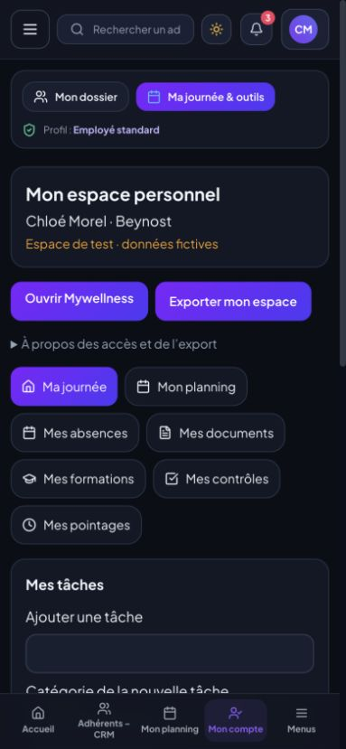
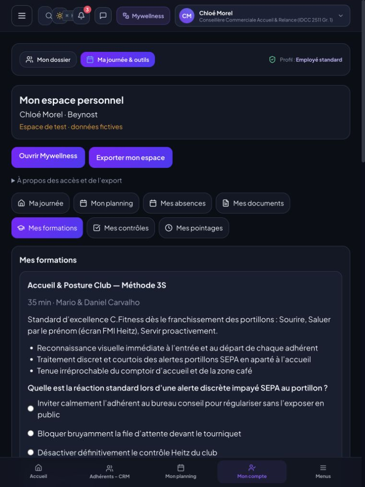

# Parcours personnels : correspondance et recette

Base du lot : `c7a0c7f`, après les PR #26, #27 et #28 approuvées/fusionnées par Antigravity. Comparaison avec l'ancien `EmployeeMobileShell` au commit `5c601ae` et `EmployeeDashboardGrid`. Branche `fix/personal-workspace-parity`, aucun déploiement par Codex.

## Parcours remis à disposition

Entrée : **Mon compte → Ma journée & outils**. **Mon dossier** conserve l'accès aux informations RH, compteurs, préférences et sous-rubriques existantes. L'espace personnel reste celui du compte connecté, même pour un administrateur ; les anciennes vues Congés/Pointages/Documents appelées depuis cet espace reçoivent aussi une portée personnelle. Les URL personnelles restent `/mon-compte/personal` pendant la navigation interne.

| Ancienne possibilité | Destination et comportement du lot | Preuve / limite |
| --- | --- | --- |
| Identité et club du salarié | En-tête personnel, club autorisé du menu commun | Chloé puis Mario contrôlés ; aucun dossier du compte précédent |
| Planning de semaine | Mon planning : horaires publiés du compte/club, pauses et mission ; lien vers la grille commune | Source : shifts du serveur ; les sources sportives externes ne sont pas simulées ici |
| CP / RTT et informations RH | Mon dossier : sous-rubriques RH existantes | Accès conservé ; ce lot ne certifie pas les calculs de compteurs |
| Ajouter et terminer une tâche | Ma journée : ajout, catégorie, coche/décoche, filtres Toutes / À faire / Faites, dates et priorités existantes | Écriture serveur, tâche du compte A invisible/non modifiable par B ; catégories contrôlées côté serveur |
| Notifications et lecture | Ma journée : messages personnels et Marquer comme lue | Lecture persistée ; lien vers les documents personnels |
| Demande de congé / RTT / formation | Mes absences : type, dates, commentaire et historique | Écriture dans la table RH `leave_requests` existante ; nouveau dossier visible dans `GET /api/dashboard` du responsable habilité ; droit ORG04-19 contrôlé |
| Nombre de jours demandé dans l'ancien formulaire | Période soumise au responsable, sans débit de compteur inventé | Le calcul de durée selon calendrier/règles RH et l'approbation restent à brancher ; ne pas prétendre avoir rétabli une gestion complète des compteurs |
| Coffre RH et consultation | Mes documents : liste personnelle, catégorie/date, contenu consultable | Aucun accès à un document tiers ; fichiers réels/publication de documents à intégrer |
| Signature de document | Recette : consultation et confirmation explicite d'un document fictif, persistées ; hors démo : simulation refusée | Aucun OTP prérempli, consentement automatique, fausse signature réelle ni certification juridique ; fournisseur de signature réel à configurer |
| Académie / quiz | Mes formations : résumé, points clés, durée, question, choix de réponse, vérification et progression | Mauvaise réponse refusée, bonne réponse choisie et enregistrée ; correction non incluse dans le GET de ce nouvel espace |
| Listes d'ouverture/fermeture | Mes contrôles : liste partagée du club, coche/décoche et auteur | Écriture serveur ; club non autorisé refusé |
| Arrivée, pause, reprise, départ | Mes pointages : action pour la session connectée, horodatage serveur et historique | Ordre contrôlé, persistance après redémarrage ; pas de faux contrôle matériel ni de PIN exposé |
| Mywellness | Lien Ouvrir Mywellness vers la connexion existante | Aucun identifiant transmis, aucune API Mywellness ou télémétrie prétendue connectée |
| Export / sauvegarde depuis l'ancien tableau | Exporter mon espace : JSON des seules données personnelles du club actif ; sauvegarde générale dans l'espace responsable existant | Téléchargement navigateur vérifié, sans jeton ; pas de restauration de sauvegarde globale depuis un compte salarié |
| Éléments agrégés Heitz/Mywellness et états réseau du prototype | Retour vers les modules communs et liens vérifiés | Les données externes, IP/latences fictives et promesses de synchronisation ne sont pas remises en scène comme des intégrations réelles |
| File de pointage hors ligne du prototype | Non rétablie comme promesse de synchronisation garantie | Journal hors ligne, reprise/idempotence et intégration badgeuse manager à réaliser/tester ; conserver ce point dans le registre fonctionnel |

## Contrat serveur

`GET /api/me/workspace/:club_id` et `POST /api/me/workspace/:club_id` exigent un Bearer valide, même si le reste de l'application utilise un fallback démo. Le salarié vient de la session ; aucun `employeeId` client n'est accepté. Clubs : `carre-de-soie` et `beynost`, avec vérification des affectations actives. Aucun mode global implicite.

Actions : `add_task`, `set_task`, `read_notification`, `set_checklist`, `answer_quiz`, `request_leave`, `punch`, `acknowledge_demo_document`. Le client ne remplace jamais l'état complet du serveur. Les mutations s'appliquent à une copie sous verrou ; la persistance réussit avant publication de l'état en mémoire et retour du résultat. Les erreurs ne publient ni fausse donnée ni faux événement d'audit. Le formulaire conserve sa saisie en cas d'échec.

Le nouveau champ `personalWorkspace` de l'état serveur possède une valeur par défaut pour lire les anciens fichiers. Les données de tâches, notifications, documents et progression sont liées à l'identifiant de session. Les contrôles sont partagés au niveau du club. Les absences utilisent la table RH existante. Les nouvelles écritures de pointage sont dans `personalWorkspace.people[employeeId].timeEntries` : les futures vues manager doivent lire cette source serveur, pas recréer une copie locale concurrente.

Le catalogue fictif de recette est extrait des données historiques du projet et chargé exclusivement en mode démo. Les documents de ce catalogue sont explicitement fictifs, sans preuve de signature/OTP ni allégation de chiffrement. En mode production neuf, aucune de ces lignes fictives n'est fournie. Aucune migration automatique des anciennes données navigateur, qui ne constituent pas une preuve serveur, n'est effectuée.

## Contrôles exécutés le 22 novembre 2026

- Réussi : `npm run lint`, `npm test` (**58 tests**), `npm run build`, `cargo test --locked` (**74 tests**), `cargo build --locked`.
- Réussi : **12 scénarios HTTP** du script `scripts/test_personal_workspace.py`, sur des serveurs temporaires en boucle locale. Session/club, données personnelles, tentative d'identité imposée, quiz, tâches, absences et doublons, demande visible au responsable via le dashboard RH existant, contrôles, notifications, ordre des pointages, simulation de document, échec disque, redémarrage/nouvelle session. Dernier scénario : serveur distinct hors démo, base neuve sans lignes fictives et refus 409 des simulations de signature.
- Réussi dans le navigateur : session commerciale Chloé, panne disque puis nouvelle tentative avec brouillon conservé, tâche cochée et filtre Faites, notification lue, demande d'absence fictive via calendrier natif, lecture de document et confirmation explicite de simulation, quiz erroné puis correct, contrôle de club, départ impossible avant arrivée puis séquence complète.
- Réussi : après rechargement, tâche/notification persistées ; bascule Mario sans tâche de Chloé ; tâche personnelle à Carré de Soie absente à Beynost et retrouvée au retour. Export JSON téléchargé : propriétaire Mario / club Beynost, aucune donnée personnelle d'un autre compte et aucun jeton.
- Formats : téléphone **390×844**, tablette **768×1024**, ordinateur **1440×1000**. Sur la fin des formations tablette, dernier bloc se termine à **y=815**, bandeau commence à **y=961**. Largeur document mesurée **761** pour viewport **768**, sans défilement horizontal sur ce parcours.

## Suite à coordonner avant une recette de production

1. Publier/gérer les vrais documents, formations, notifications, tâches assignées et contrôles par les responsables ; alimenter ce contrat serveur sans remettre les tableaux locaux du prototype en source de vérité.
2. Brancher le traitement/approbation des demandes, les règles de durée et de compteurs. Le nouveau dépôt de demande est confirmé côté serveur et visible au dashboard, pas une chaîne RH complète de validation/paie certifiée.
3. Faire consommer les nouveaux pointages serveur par les vues badgeuse/manager, les anomalies, rapports et exports. Ajouter la reprise hors ligne/idempotente avant d'annoncer une synchronisation fiable.
4. Choisir et intégrer un fournisseur réel de documents/signature/identification. La confirmation fictive n'est pas une signature de contrat réel.
5. Prévoir une migration contrôlée des éventuelles données de l'ancien navigateur, après export et vérification ; ne pas importer aveuglément une sauvegarde client globale.
6. Compléter la matrice des délégations fines pour tâches/contrôles/formations/pointage. ORG04-19 et les frontières compte/club sont testés ; pas de certification exhaustive des six profils et 44 actions.
7. Ergonomie commune tablette : bandeau supérieur encore chargé à 768 px (recherche comprimée près des raccourcis). Correction distincte à coordonner sur AdminShell ; ne pas confondre ce point avec les formulaires personnels validés.
8. Tester Safari natif, appareils physiques, accessibilité assistée et coupures réseau réelles. Aucun matériel ni service fournisseur n'a été actionné dans cette recette.

**Décision : validation partielle**, sur les parcours et frontières ci-dessus. Les fonctions à terminer restent inventoriées ; ce rapport ne signifie ni parité globale avec Skello, ni préparation complète à la production.

Antigravity a confirmé sur #21 la réservation des fichiers et l'absence de prochains déploiements sans autorisation distincte. PR de relecture uniquement. Le retour à un ancien binaire nécessite de conserver une sauvegarde : un logiciel ancien ignorant `personalWorkspace` pourrait perdre ce champ lors d'une réécriture ultérieure du fichier d'état.
